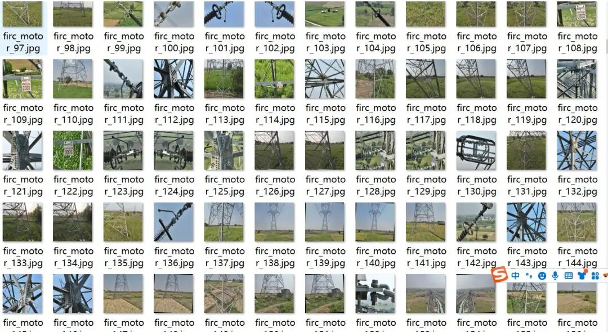
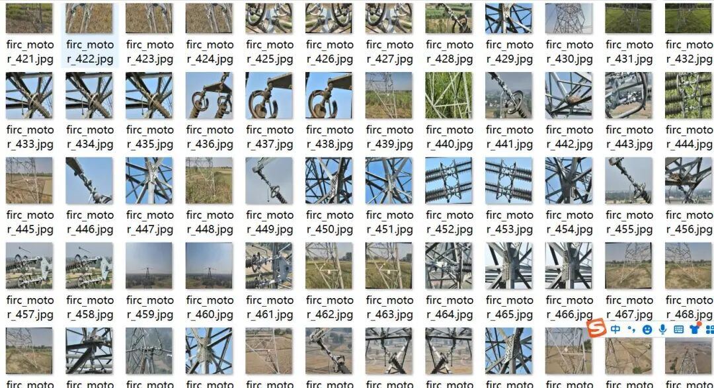
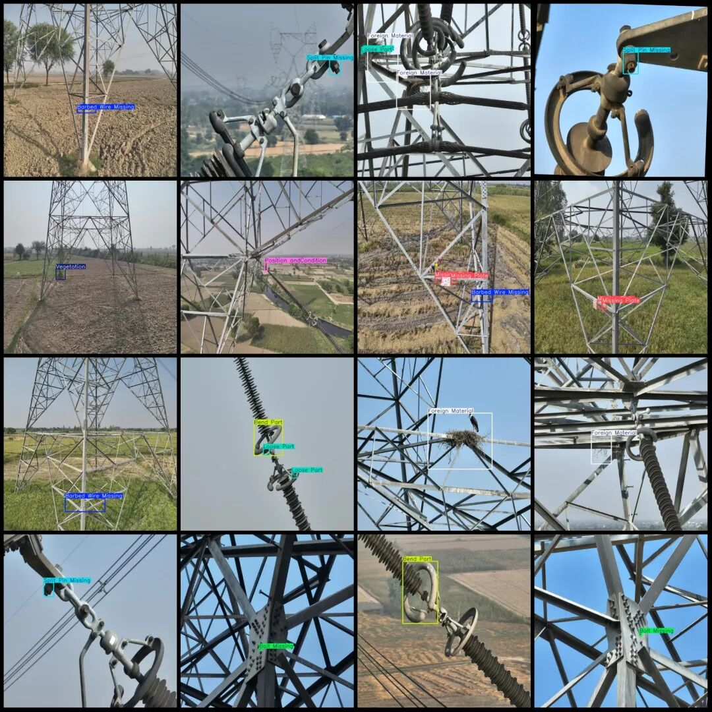
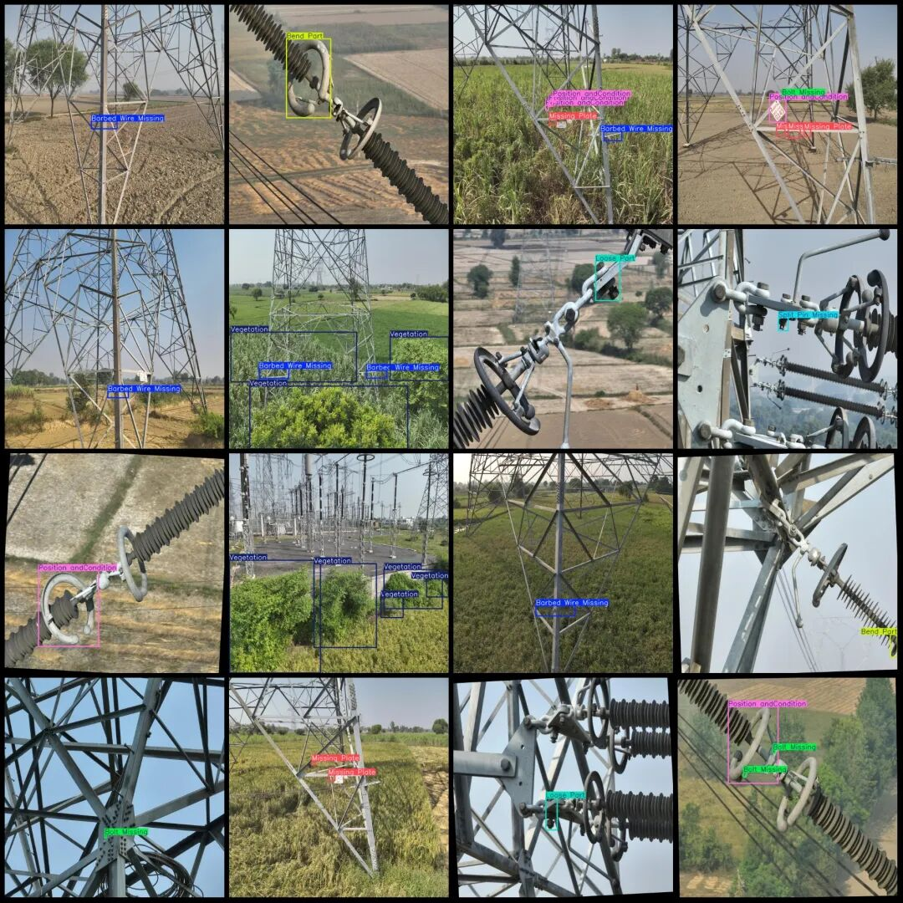

# Power Scene Transmission Line Defect Detection Dataset VOC+YOLO format with 1111 images and 10 categories

Dataset format: Pascal VOC format + YOLO format (txt file without split path, only contains jpg images and corresponding VOC format xml files and yolo format txt files)

Number of images (number of jpg files): 1111

Number of annotations (number of xml files): 1111

Number of annotations (number of txt files): 1111

Label category count: 10

Label category names (note that the order of categories in the YOLO format does not correspond to this, but is based on the labels folder's classes.txt): ["Barbed Wire Missing", "Bend Part", "Bolt Missing", "Foreign Material", "Loose Part", "Missing Part", "Missing Plate", "Position andCondition", "Split Pin Missing", "Vegetation"]

Number of boxes labeled in each category:

Barbed Wire Missing (Wire mesh with spikes missing) Frame count = 198

Bend Part (Component Bending) Frame Count = 122

Bolt Missing (Loose bolt) Frame count = 379

Foreign Material (Foreign object) Frame count = 178

Loose Part (Part loose) Frame count = 210

Missing Part (Part Missing) Box Count = 11

Missing Plate (sheet missing) Frames = 368

Position and Condition (Position and State Abnormality) Box Count = 213

Split pin missing (gapping pin missing) frame count = 190

Vegetation (vegetation) frame count = 310

Application Fields: These categories are generally used for inspections of railways, power facilities, or other infrastructure, detecting structural or safety defects.

Total frame count: 2179

Image resolution: 640x640

Existence of dataset augmentation: Yes, more than half are data augmented images. The original images number about 450.

Using labelImg:

Annotation rules: Draw a rectangle around the category.

Important Notice: No

Special : This dataset does not guarantee the accuracy of the trained models or weight files.

Image Preview:

Annotation example:

## Payment

Here is a pay link on Stripe ( https://buy.stripe.com/3cs8yP7sY87d0vu9AB ). Please contact me lonlonago@foxmail.com after funding $89, and I will send you a complete data files , thank you!

